

# Sisma 2016 — the crater in numbers

Interactive maps of the 2016 central-Italy earthquake crater (138 comuni in Abruzzo, Lazio, Marche and Umbria), built with [ixmaps-gl](https://github.com/gjrichter/ixmaps-gl). Live at **https://gl.ixmaps.com/stage/censimenti_sisma_2016/**

The crater, outline, SS4 Salaria and region geodata, the official-source tables and the PNRR extract are hosted in [gjrichter/ixmaps-data](https://github.com/gjrichter/ixmaps-data/tree/main/by-project/sisma-2016-cratere).

---

<a href="https://gl.ixmaps.com/stage/censimenti_sisma_2016/sisma_2016_italia_censimenti_compare_procom_2023.html">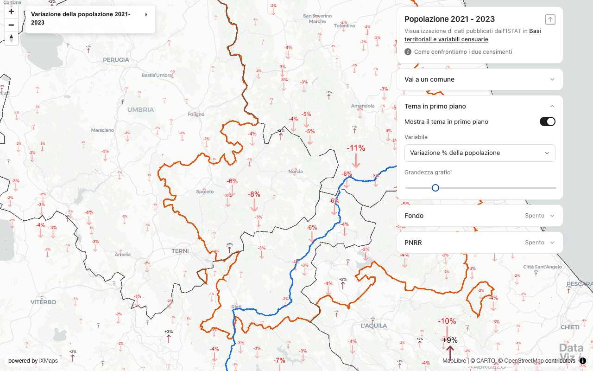</a> 
<b>Census 2021 vs 2023 — population change</b> 
Change in population, education and foreign residents between the ISTAT 2021 census and the 2023 permanent census, per comune and per census section. Collapsible cards for the foreground theme, the background (Fondo) and the PNRR layer; the crater outline, the SS4 Salaria and the four regions sit under the charts. 
<a href="https://gl.ixmaps.com/stage/censimenti_sisma_2016/sisma_2016_italia_censimenti_compare_procom_2023.html">OPEN →</a> &nbsp;·&nbsp; <a href="https://gjrichter.github.io/MapCodeViewer/?url=https://gl.ixmaps.com/stage/censimenti_sisma_2016/sisma_2016_italia_censimenti_compare_procom_2023.html">see code →</a>

<a href="https://gl.ixmaps.com/stage/censimenti_sisma_2016/sisma_2016_italia_censimenti_compare_procom_2023.html">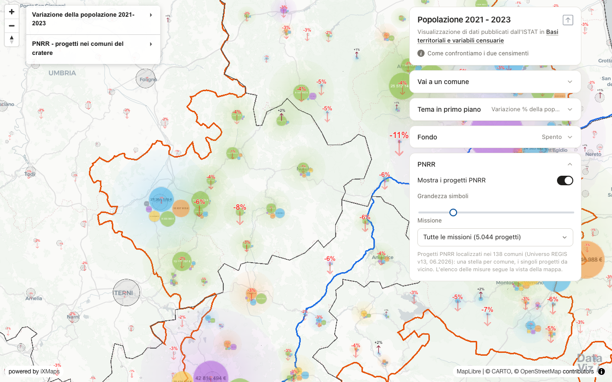</a> 
<b>Census 2021–2023 with the PNRR layer on</b> 
The PNRR card switched on: one star per comune of the crater, sized by the amount and split by mission, over the census arrows. A slider sizes the symbols. 
<a href="https://gl.ixmaps.com/stage/censimenti_sisma_2016/sisma_2016_italia_censimenti_compare_procom_2023.html">OPEN →</a> &nbsp;·&nbsp; <a href="https://gjrichter.github.io/MapCodeViewer/?url=https://gl.ixmaps.com/stage/censimenti_sisma_2016/sisma_2016_italia_censimenti_compare_procom_2023.html">see code →</a>

<a href="https://gl.ixmaps.com/stage/censimenti_sisma_2016/sisma_2016_italia_censimenti_compare_procom_2023.html">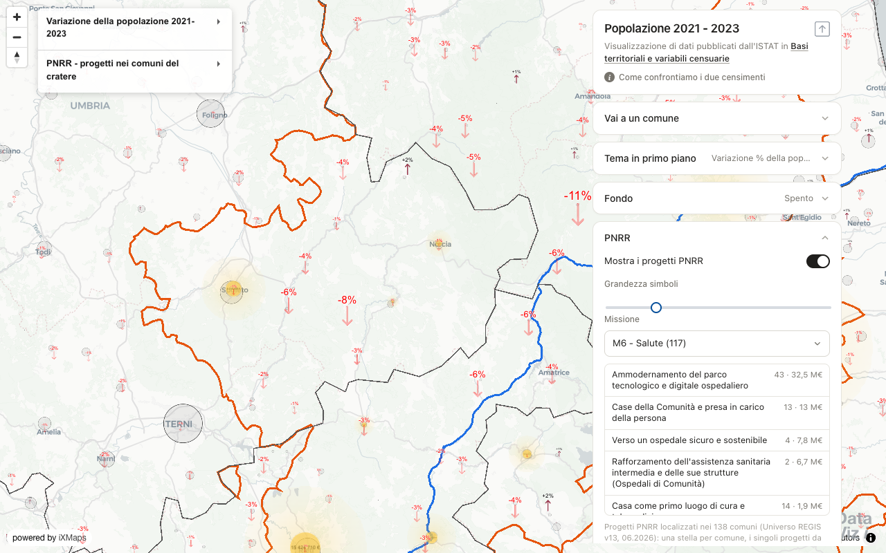</a> 
<b>PNRR — one mission, measures in view</b> 
Selecting a mission (here M6, Salute) lists its measures with project count and amount, clipped to the map view; click a measure to filter the stars and the single projects. 
<a href="https://gl.ixmaps.com/stage/censimenti_sisma_2016/sisma_2016_italia_censimenti_compare_procom_2023.html">OPEN →</a> &nbsp;·&nbsp; <a href="https://gjrichter.github.io/MapCodeViewer/?url=https://gl.ixmaps.com/stage/censimenti_sisma_2016/sisma_2016_italia_censimenti_compare_procom_2023.html">see code →</a>

<a href="https://gl.ixmaps.com/stage/censimenti_sisma_2016/sisma_2016_italia_censimenti_compare_procom_2023.html">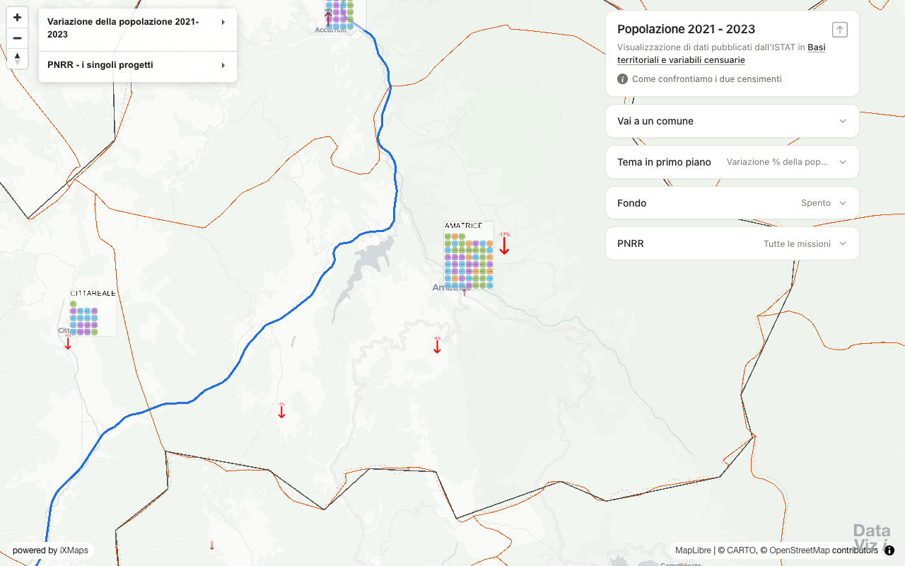</a> 
<b>PNRR — single projects</b> 
Zoomed in, every project of a comune is a small coloured cell (colour = mission); click one for its summary, implementing body, funding and status. 
<a href="https://gl.ixmaps.com/stage/censimenti_sisma_2016/sisma_2016_italia_censimenti_compare_procom_2023.html">OPEN →</a> &nbsp;·&nbsp; <a href="https://gjrichter.github.io/MapCodeViewer/?url=https://gl.ixmaps.com/stage/censimenti_sisma_2016/sisma_2016_italia_censimenti_compare_procom_2023.html">see code →</a>

<a href="https://gl.ixmaps.com/stage/censimenti_sisma_2016/sisma_2016_italia_censimenti_compare_procom.html">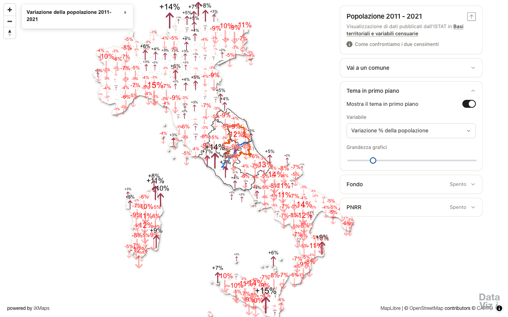</a> 
<b>Census 2011 vs 2021 — population change</b> 
The same sidebar for the 2011–2021 comparison: arrows for the change in population, age groups, education and foreign residents, with the crater layers underneath. 
<a href="https://gl.ixmaps.com/stage/censimenti_sisma_2016/sisma_2016_italia_censimenti_compare_procom.html">OPEN →</a> &nbsp;·&nbsp; <a href="https://gjrichter.github.io/MapCodeViewer/?url=https://gl.ixmaps.com/stage/censimenti_sisma_2016/sisma_2016_italia_censimenti_compare_procom.html">see code →</a>

<a href="https://gl.ixmaps.com/stage/censimenti_sisma_2016/sisma_2016_italia_censimenti_compare_procom.html">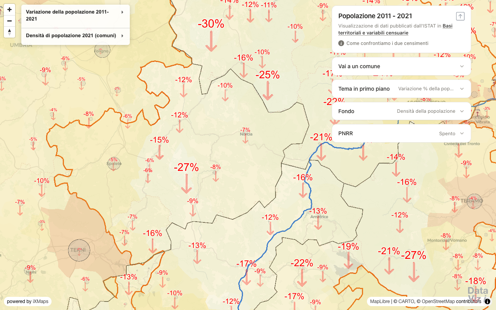</a> 
<b>Census 2011–2021 with the background on</b> 
Fondo switched on: population density per comune zoomed out, per census section zoomed in; other backgrounds show age, education or the dominant origin of foreign residents. 
<a href="https://gl.ixmaps.com/stage/censimenti_sisma_2016/sisma_2016_italia_censimenti_compare_procom.html">OPEN →</a> &nbsp;·&nbsp; <a href="https://gjrichter.github.io/MapCodeViewer/?url=https://gl.ixmaps.com/stage/censimenti_sisma_2016/sisma_2016_italia_censimenti_compare_procom.html">see code →</a>

<a href="https://gl.ixmaps.com/stage/censimenti_sisma_2016/sisma_2016_official_sources.html">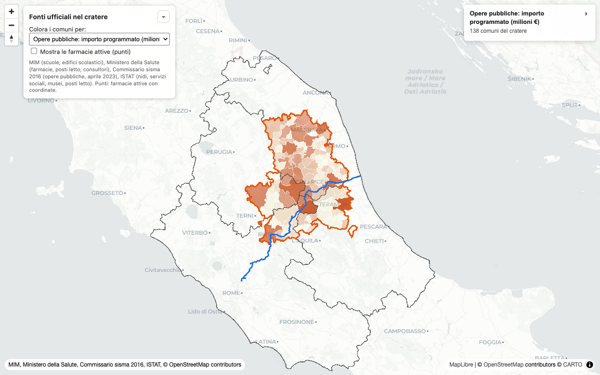</a> 
<b>Official sources in the crater</b> 
Per-comune measures from MIM, the Ministry of Health, the Commissario sisma 2016 (public works, April 2023) and ISTAT (nurseries, social services, museums, hospital beds), with the active pharmacies as points. 
<a href="https://gl.ixmaps.com/stage/censimenti_sisma_2016/sisma_2016_official_sources.html">OPEN →</a> &nbsp;·&nbsp; <a href="https://gjrichter.github.io/MapCodeViewer/?url=https://gl.ixmaps.com/stage/censimenti_sisma_2016/sisma_2016_official_sources.html">see code →</a>

<a href="https://gl.ixmaps.com/stage/censimenti_sisma_2016/sisma_2016_social_infrastructure.html">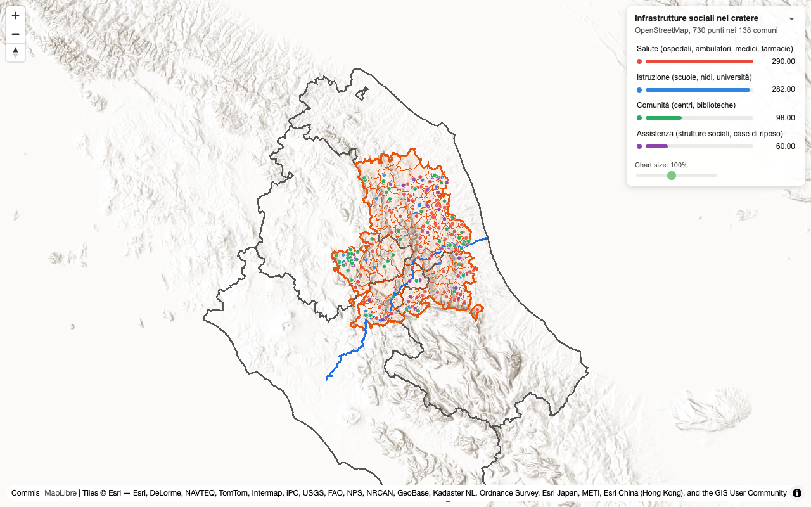</a> 
<b>Social infrastructure (OpenStreetMap)</b> 
730 OpenStreetMap points in the 138 comuni — education, health, care and community facilities — over the crater outline, the SS4 Salaria and the region borders. 
<a href="https://gl.ixmaps.com/stage/censimenti_sisma_2016/sisma_2016_social_infrastructure.html">OPEN →</a> &nbsp;·&nbsp; <a href="https://gjrichter.github.io/MapCodeViewer/?url=https://gl.ixmaps.com/stage/censimenti_sisma_2016/sisma_2016_social_infrastructure.html">see code →</a>

<a href="https://gl.ixmaps.com/stage/censimenti_sisma_2016/sisma_2016_isochrone_ospedali.html">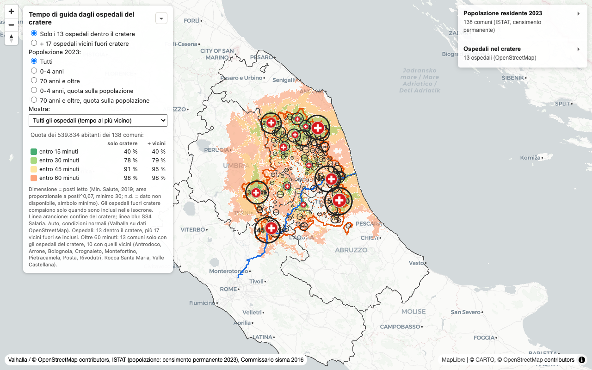</a> 
<b>Driving time from the hospitals</b> 
Isochrones (15/30/45/60 minutes) from the 13 hospitals in the crater, optionally with 17 nearby hospitals outside it; share of the 2023 population covered, total or by age group. 
<a href="https://gl.ixmaps.com/stage/censimenti_sisma_2016/sisma_2016_isochrone_ospedali.html">OPEN →</a> &nbsp;·&nbsp; <a href="https://gjrichter.github.io/MapCodeViewer/?url=https://gl.ixmaps.com/stage/censimenti_sisma_2016/sisma_2016_isochrone_ospedali.html">see code →</a>

<a href="https://gl.ixmaps.com/stage/censimenti_sisma_2016/sisma_2016_nidi_popolazione.html">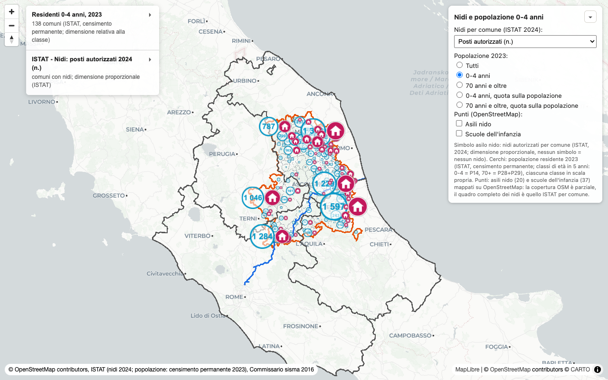</a> 
<b>Nurseries and population 0–4</b> 
Authorised nursery places per comune (ISTAT 2024) against the 2023 population — all ages, 0–4 or 70+, as counts or shares — with OpenStreetMap nurseries and infant schools as optional points. 
<a href="https://gl.ixmaps.com/stage/censimenti_sisma_2016/sisma_2016_nidi_popolazione.html">OPEN →</a> &nbsp;·&nbsp; <a href="https://gjrichter.github.io/MapCodeViewer/?url=https://gl.ixmaps.com/stage/censimenti_sisma_2016/sisma_2016_nidi_popolazione.html">see code →</a>

<a href="https://gl.ixmaps.com/stage/censimenti_sisma_2016/sisma_2016_rischi_comuni_sidebar.html">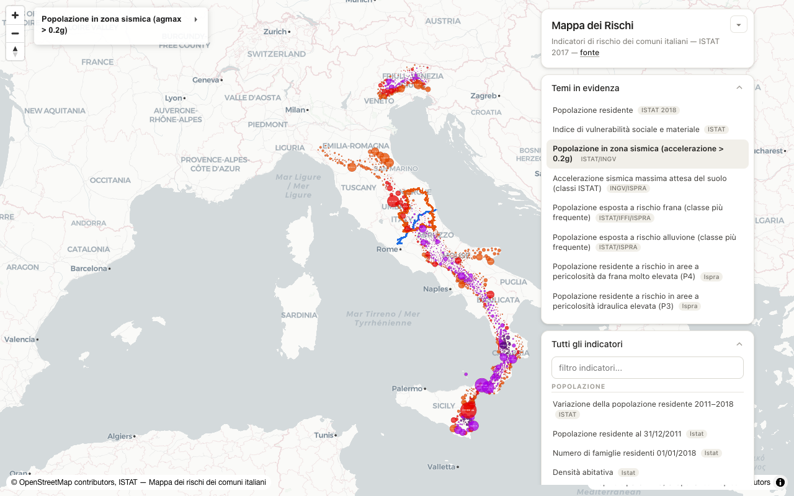</a> 
<b>Risk map of the Italian comuni</b> 
ISTAT risk indicators for all comuni (seismic, landslide and flood exposure, social vulnerability, population) as a theme explorer with a filterable indicator list; the earthquake crater and the SS4 Salaria are drawn on top. Port of the ixmaps-flat original. 
<a href="https://gl.ixmaps.com/stage/censimenti_sisma_2016/sisma_2016_rischi_comuni_sidebar.html">OPEN →</a> &nbsp;·&nbsp; <a href="https://gjrichter.github.io/MapCodeViewer/?url=https://gl.ixmaps.com/stage/censimenti_sisma_2016/sisma_2016_rischi_comuni_sidebar.html">see code →</a>

---

The two census pages explain their method in [censimenti_2011_2021_metodo_di_confronto.md](censimenti_2011_2021_metodo_di_confronto.md).
